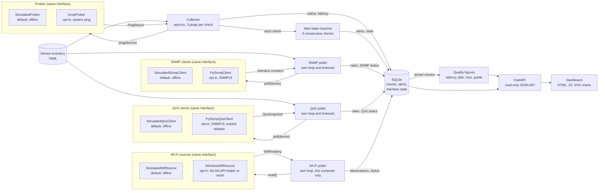

# NetMonLT

[](https://github.com/ImLukeRT/Test-/actions/workflows/ci.yml)

**A lightweight network monitoring platform in Python.** NetMonLT polls devices for
reachability and latency, reads interface traffic and error counters over SNMP, stores the
history in SQLite, grades network quality (latency, jitter and packet loss), raises alerts when
a device changes state, optionally watches this computer's own Wi-Fi signal, and serves a live web
dashboard with historical charts. It runs fully offline with simulated devices, and can optionally
monitor real devices over ICMP and SNMPv3, restricted to targets you list explicitly and are
authorised to monitor.


*Simulated data (the SIMULATED DATA badge is always shown in that mode). The chart shows two
outages (red) and a period when the app was stopped (hatched).*

This is a portfolio project built to show how a monitoring system separates **measurement**
(probes), **storage**, **alerting** and **presentation**, and how it avoids two classic
monitoring mistakes: false alarms from noisy checks, and mistaking "no data" for "down".

## Key features

- **Simulated devices by default.** Deterministic, scripted outages, packet loss and high
  latency, so it demos anywhere with no hardware, network access or admin rights.
- **Opt-in real ICMP monitoring.** Runs the operating system's `ping`, only against devices
  marked `authorized: true`. Never scans or discovers: ranges, CIDR blocks, wildcards and
  multicast/broadcast addresses are rejected.
- **Pluggable probe interface.** The collector, database, alerts and dashboard don't know
  whether results are simulated or real.
- **SNMP interface statistics.** Per-interface status, in/out traffic rates and error/discard
  counts from the standard IF-MIB. Simulated by default (including counter rollover, a device
  restart and a vanishing interface); real polling is opt-in, SNMPv3 only, with credentials taken
  from environment variables and never written to a file, the database, the API or the log.
- **Network quality.** Average latency, jitter and packet loss per device, an Excellent / Good /
  Fair / Poor / Unknown grade from thresholds you can configure, and historical jitter and loss
  charts. All calculated from the ICMP checks already in SQLite, with the formulas stated and
  missing data never counted as zero. It measures performance; it does not verify or enforce QoS.
- **Wi-Fi signal of this computer (opt-in, Windows).** Connection state, signal quality %, link
  rates, radio type, channel and, only when the OS reports one, RSSI in dBm, with history and a
  configurable low-signal warning. Local-only: it never scans for networks, never records other
  people's SSIDs and masks yours by default. Every figure is labelled reported, simulated or
  unavailable; nothing is estimated. Simulated by default so it works on Linux CI and on PCs with
  no Wi-Fi adapter.
- **QoS telemetry (opt-in, read-only).** The queue, traffic-class and drop counters a device itself
  reports for its own QoS policy, through an explicit, documented adapter (today: the standard
  DIFFSERV-MIB), with correct rollover, reset and discontinuity handling, history and per-device
  availability. A deterministic, clearly labelled simulation shows congestion with
  queue-specific drops. It is not the ICMP quality grade, not interface discards and not
  observed DSCP, and counters existing does not prove QoS works.
- **Alerts without alert storms.** A device's state changes only after 3 consecutive checks
  agree. Alerts are stored in SQLite, survive restarts, and never repeat while the state is
  unchanged.
- **Honest history.** The latency chart distinguishes **DOWN** (checked, no reply), **NO DATA**
  (nothing was measured) and a genuine **0 ms** reply. Long windows are downsampled on the
  server.
- **Dashboard with no framework.** Plain HTML, JavaScript and hand-built SVG, no CDN, so it works
  offline. Shows stale data and API failures clearly.
- **Tested.** 1185 automated tests, run with lint on Ubuntu and Windows in CI. Tests never touch a
  network and never need an SNMP device.

## Quick start (simulated demo)

Needs Python 3.11 or newer and [uv](https://docs.astral.sh/uv/) (`winget install astral-sh.uv`
on Windows). No Docker, admin rights or network access needed.

```powershell
git clone https://github.com/ImLukeRT/Test-.git
cd Test-
uv sync
uv run netmonlt
```

Open <http://127.0.0.1:8000>. The simulated `access-switch` fails 30 seconds after start (a
critical DOWN alert appears at about 40 s) and recovers at 60 s (a recovery alert at about 70 s).
`wifi-ap` (lossy) and `branch-vpn` (slow) stay degraded by design. The **Interfaces (SNMP)** table
fills in within about 10 s; see [SNMP interface monitoring](#snmp-interface-monitoring).

**Without uv:** `python -m venv .venv`, activate it (`.venv\Scripts\Activate.ps1` on Windows,
`source .venv/bin/activate` elsewhere), then `pip install -e . pytest httpx2 ruff` and `netmonlt`.
(Real SNMP polling also needs `pip install -e '.[snmp]'`; the simulated demo does not.)

Options: `--inventory PATH`, `--db PATH`, `--host ADDR` (default `127.0.0.1`), `--port N`
(default 8000). There is no authentication, so keep the default localhost binding.

**If something goes wrong**

- `inventory file not found`: run it from the repository root (where `config/` is), or pass
  `--inventory`.
- `address already in use`: another instance is running; stop it or use `--port 8001`.
- Chart says "No measurements yet": wait one polling interval (5 s).
- Start fresh: stop the app and delete the `data/` folder.

**Guided demo:** [docs/DEMO.md](docs/DEMO.md) is a 5-minute walkthrough of the outage, the
recovery alert, the history chart and the difference between DOWN and NO DATA.


## How it works



| Component | File | Responsibility |
|---|---|---|
| Inventory | `inventory.py` | Loads and strictly validates the YAML (rejects unknown and duplicate keys, bad numbers, unsafe real-mode targets). |
| Probes | `probes/` | `Prober` interface; `SimulatedProber` and `IcmpProber` implement it. A probe that *cannot* measure raises `ProbeError`. |
| Collector | `collector.py` | Polls every device concurrently on a schedule, with a per-probe timeout. Stores each check, then feeds it to the alert state machine. |
| Alerts | `alerts.py` | Pure state machine: confirms state changes, raises alerts, handles restarts and gaps. |
| Interface maths | `ifstats.py` | Pure functions: IF-MIB table parsing and counter-to-rate maths (first sample, rollover, reset, gap, absent interfaces). |
| Network quality | `quality.py` | Pure functions over stored checks: mean latency, jitter, packet loss, grading and the bucketed series for the charts. Reads existing rows; stores nothing. |
| Wi-Fi | `wifi.py`, `wifi_windows.py`, `wifi_wlanapi.py`, `wifi_poller.py` | Data model and validation, SSID privacy, `netsh` parsing, the simulated source, low-signal warning and history maths; the Windows source, which runs the WLAN API helper or `netsh` as a separate, time-limited process; the native `ctypes` helper itself; and a polling loop that is separate from the ICMP collector. |
| QoS | `qos.py`, `qos_adapters.py`, `qos_sim.py`, `qos_poller.py` | Pure rate maths for device-reported QoS counters (rollover, reset, restart, discontinuity, gaps); the explicit adapter registry with the DIFFSERV-MIB adapter; the deterministic simulated client; and a polling loop that is separate from every other collector. The real SNMPv3 client lives in `snmp_pysnmp.py`. |
| SNMP | `snmp.py`, `snmp_pysnmp.py`, `snmp_poller.py` | `SnmpClient` interface, the deterministic simulated client, the real SNMPv3 client (optional dependency) and a polling loop that is separate from the ICMP collector. |
| Storage | `storage.py` | SQLite with plain SQL: one shared connection, a lock, WAL mode. Windowed and downsampled history queries. |
| API and dashboard | `api.py`, `templates/dashboard.html` | Read-only JSON endpoints and a single-page dashboard that polls them. |

Design decisions worth knowing:

- **Probe interface.** One protocol separates *measuring* from everything else. That is what
  makes the simulator, the real prober and deterministic tests possible.
- **System `ping`, not raw sockets.** Raw ICMP needs administrator/root. The OS `ping` is already
  privileged on Windows, macOS and Linux, so it works for a normal user with no extra
  dependency. The cost is parsing its text output, which is why only Linux output is verified.
- **A probe error is not an outage.** If `ping` is missing, a hostname doesn't resolve or a probe
  times out, nothing is recorded as DOWN. The device becomes `unknown` or `stale` instead.
- **Confirmation before alerting.** One check is noisy (one lost packet in three marks it
  `degraded`). In the simulated demo, naive change-detection gives about 110 state changes per
  20 minutes against about 7 confirmed alerts (measured over 8 simulator seeds).
- **No invented history.** After a restart or a long gap the alert state is re-baselined
  silently, so a change that happened while the app was off never produces a fake alert.
- **Gaps are computed on the server,** so "no data" is testable in Python and the browser never
  has to guess.

Status rules: three pings per check; `down` if none reply, `degraded` at 20% loss or more or an
average of 150 ms or more, otherwise `up`. A device is `stale` when its newest check is older
than 3 poll intervals plus the 10 s probe timeout.

## Real ICMP monitoring (opt-in)

Real probing never happens by default. It needs a separate inventory file with `mode: real`, and
every device must carry `authorized: true`.

**Try it safely (pings only your own computer):**

```powershell
uv run netmonlt --inventory config/devices.real.example.yaml
```

The page is labelled **LIVE · ICMP**, and data goes to `data/netmonlt-real.db`, never into the
simulated database.

**Monitor your own devices:** copy the example to `config/devices.real.yaml` (git-ignored, so
private addresses stay out of the repo), list devices you own or are permitted to monitor, and
run `uv run netmonlt --inventory config/devices.real.yaml`:

```yaml
mode: real
poll_interval_s: 10        # minimum 5 in real mode
devices:
  - name: home-router
    address: 192.168.1.1   # one IPv4 address or one hostname
    type: router
    authorized: true       # required: your acknowledgement for this device
```

**Safety rules (enforced in code, at load time and again inside the prober):** opt-in per file
and per device; each address is one host, never a range; multicast, broadcast, `0.0.0.0` and
legacy shorthand such as `0xe0.0.0.1` are rejected; the address is passed to `ping` as a single
argument with no shell, so `-f` or `1.2.3.4; id` are refused; minimum 5 s poll interval, three
echo requests per check, a 1 s per-packet timeout and at most 64 pings at once. At startup it
prints the targets it will probe and pings loopback once; if `ping` doesn't work it stops with a
clear message. `authorized: true` is an acknowledgement, not a technical check.

| What `ping` shows | Result |
|---|---|
| All replies, low latency | `up` |
| Some lost, or average 150 ms or more | `degraded` |
| No replies, or "unreachable" | `down` |
| `ping` can't run, unresolvable host, no permission, unrecognised output | not recorded and logged: `unknown`/`stale`, never `down` |

**Platform notes:** Linux needs the `ping` command (`sudo apt install iputils-ping`). Windows
reports whole milliseconds (`time<1ms` is shown as 0.5 ms). On non-English Windows, a device that
does *not* answer is recognised from English phrases, so it may show `unknown`/`stale` instead of
`down`. On Windows a hostname that resolves to IPv6 may show `unknown`; prefer IPv4 addresses.
IPv4 and ICMP only: a firewall that drops ping makes a healthy host look down.

## Alerts

An alert is raised when a device's *confirmed* state changes: to `down` is `critical`, to
`degraded` is `warning`, to `up` (recovery) is `info`. Each alert stores the device, time,
severity, the change and a message such as
`access-switch is DOWN: no reply to 3 pings (was up for 30s)`, and is shown under **Recent
alerts** and logged to the console.

- **3 consecutive checks** must agree before the state changes, so with the 5 s demo interval an
  alert appears about 10 s after a change starts and a one- or two-check blip raises nothing.
- **Restarts:** the confirmed state is stored in SQLite, so a half-confirmed change keeps counting
  and nothing is alerted twice. A device with no stored state gets a silent baseline. If the last
  check is older than the stale limit, the old state is discarded and re-baselined silently.
  Probe errors never produce alerts.
- Not included: notifications (email, SMS, webhooks), acknowledgement, per-device rules,
  configurable thresholds and alert pruning.

## Latency history chart

Pick a device and a window (15 min default, 1 h, 6 h, 24 h, 7 d). The chart refreshes every 5 s.

| You see | It means |
|---|---|
| Blue line with a pale min-to-max band | The device replied; a reply of 0 ms sits on the 0 baseline with a marker. |
| Red zone, a break in the line, red strip cells | **DOWN:** the device was checked and did not reply. Never drawn as 0 ms. |
| Grey hatched zone | **NO DATA:** nothing was measured (app stopped, probes failing). Says nothing about the device. |

A gap is shown when two checks are more than 3 poll intervals plus 10 s apart. If a device's
history is shorter than the window, the chart shows just that history. Long windows are grouped
server-side into at most about 300 buckets; a bucket is `down` only if every check in it was
down, so a shorter outage appears as an amber cell (hover for "N of M checks were down").
Devices with no history, stale devices and API errors each have an explicit message.

## Network quality

The **Network quality** section turns the ICMP checks already stored in SQLite into three figures
and a grade per device. Nothing is probed or stored for it: the collector and database are
unchanged, and the figures are calculated on request from the `checks` table.

| Figure | Calculation | Not counted |
|---|---|---|
| **Latency** | Mean round-trip time of the replies received in the window (each check's average weighted by its replies). | Checks with no reply have no latency; they are never treated as 0 ms. |
| **Jitter** | Mean absolute difference, in ms, between the average round-trip times of two **consecutive checks that both received replies**: `mean(abs(rtt[n] - rtt[n-1]))`. | A pair is not formed across a down check or a monitoring gap (more than 3 poll intervals plus 10 s). |
| **Packet loss** | `100 * (probes sent - replies received) / probes sent`, over the checks actually made (3 probes each). | Time with no checks (app stopped, probe errors) is a **gap**: neither loss nor success. |

**What jitter is not.** It is a simple latency-variation figure, not the RFC 3550 interarrival
jitter used for RTP media, and ICMP echo measures the round trip, so it says nothing about
one-way delay. Each check averages up to 3 pings before the difference is taken, which smooths
short bursts: it will read lower than a per-packet figure on the same link.

### Grades

Each figure is graded against upper bounds (inclusive): up to the `excellent` bound is
Excellent, up to `good` is Good, up to `fair` is Fair, above that Poor. A device's grade is the
**worst of its three figures**, and the dashboard shows which one limits it.

| Figure | Excellent | Good | Fair | Poor |
|---|---|---|---|---|
| Latency (ms) | up to 30 | up to 80 | up to 150 | above 150 |
| Jitter (ms) | up to 5 | up to 15 | up to 30 | above 30 |
| Loss (%) | up to 0.5 | up to 2 | up to 5 | above 5 |

**These are application-level heuristics, not a QoS standard.** They are reasonable starting
points for a general-purpose link; a voice circuit, a satellite link and a LAN deserve different
numbers. Change them in the inventory:

```yaml
quality:
  latency_ms: {excellent: 30, good: 80, fair: 150}   # give all three, in increasing order
  jitter_ms: {excellent: 5, good: 15, fair: 30}
  loss_pct: {excellent: 0.5, good: 2, fair: 5}       # percent, at most 100
  window_s: 900            # default period (60 to 604800); the dashboard can change it
  min_checks: 10           # fewer checks in the window: Unknown
  min_jitter_pairs: 3      # pairs of consecutive successful checks needed to grade jitter
  max_gap_fraction: 0.5    # more of the window than this unmeasured: Unknown
```

The block is optional and every key is optional; bad values stop startup with a message.

### When the grade is Unknown (or Poor because nothing replies)

A grade is only given when there is enough trustworthy data, and the reason is shown:

| Situation | Result |
|---|---|
| The device has never been checked, or has no checks in the window | Unknown |
| The newest check is older than the stale limit (3 poll intervals plus 10 s) | Unknown, "stale" |
| Fewer than `min_checks` checks in the window | Unknown, "insufficient samples" (figures are still shown) |
| More than `max_gap_fraction` of the window has no checks | Unknown, "sparse history" |
| Fewer than `min_jitter_pairs` pairs of consecutive successful checks | Unknown (loss and latency are still shown) |
| Checks were made but **no probe was answered** | Poor, "no replies": latency and jitter show a dash, never 0 |
| Part of the window was down | Those checks count as loss; latency and jitter use only the replies |

A device whose history is shorter than the window is not penalised for the time before its
first check.

### Charts

Under the table, **Jitter over time** (line) and **Packet loss over time** (bars) use the device
and window chosen in Latency history. Each point or bar covers a bucket of at least six poll
intervals, so it holds enough probes for a percentage to mean something. Missing data is never
drawn as a value: empty buckets are left out, no-data periods are hatched, jitter that cannot
be measured breaks the line, and "measured, no loss" is a thin green line, which differs from
"not measured". Dashed lines mark your Excellent, Good and Fair limits. Hover for the exact
values and probe counts.

### Network performance is not QoS enforcement

This feature observes how ICMP echo traffic performs. It does **not** verify that DSCP marking,
traffic shaping, queue management or any other QoS policy is configured or working: ICMP may
be treated differently from the traffic a policy targets, the probes carry no particular DSCP
value, and routers often rate-limit or deprioritise ICMP. A good grade means "ping looked
healthy", not "the voice class gets priority".

### In the simulated demo

After a minute or two of data (10 checks are needed), `config/devices.sim.yaml` shows every
kind of grade, deterministically (the simulation is seeded):

| Device | Grade | Why |
|---|---|---|
| `core-router`, `edge-firewall`, `file-server` | Excellent | Low latency, steady, no loss |
| `voice-gateway` | Fair | About 30 ms latency (Excellent or Good) and no loss, but jitter of about 20 ms: **graded on jitter** |
| `access-switch` | Poor, then Fair, then Excellent | The scripted 30 s outage counts as loss: Poor at first, Fair once the window holds about 10 minutes of checks (under 5% loss), Excellent again (via Good) as the outage leaves the 15-minute window |
| `wifi-ap` | Poor | 40% simulated packet loss |
| `branch-vpn` | Poor | 170 ms latency |

## Wi-Fi signal monitoring (opt-in, local only, Windows first)

This watches the Wi-Fi link of **the computer running NetMonLT**, which is useful for explaining
"the network felt slow" (a weak signal, a roam, a drop) next to the ICMP and SNMP data. It is a
home or lab feature, not a wireless survey tool, and it needs no enterprise equipment.

**What it will never do:** scan for nearby networks, record anyone else's SSID, connect to or
leave a network, or collect the access point's MAC address (BSSID), the saved profile name or any
key. The dashboard panel and the config say so, and the tests check it. It is **off unless the
inventory says `wifi: {enabled: true}`.**

### What is real, estimated, unavailable or simulated

Every figure in the panel and API is exactly one of: **reported** (read from the operating
system), **simulated** (from the built-in simulator, shown with a SIMULATED badge) or
**unavailable** (shown as a dash, never as zero). **Nothing is estimated.**

| Figure | From the Windows WLAN API (preferred) | From `netsh wlan` (fallback) | Simulated |
|---|---|---|---|
| Connection state | Reported: the adapter's state | Reported (English labels only) | Simulated |
| SSID | Reported, then masked or hidden per `ssid_privacy` before it is stored | Same | Simulated name |
| Signal quality % | Reported: Windows' 0 to 100 "signal quality" | Reported | Simulated |
| **RSSI (dBm)** | Reported **only if the driver answers the RSSI query**; otherwise unavailable | Reported only if the output has an `Rssi` line; otherwise unavailable | Simulated, labelled as such |
| Link rates | Reported: negotiated receive and transmit rate (not throughput) | Reported | Simulated |
| Radio type | Reported: the PHY type, shown as 802.11n, ac, ax and so on | Reported | Simulated |
| Channel | Reported if the adapter provides it, else unavailable | Reported | Simulated |
| Anything while not connected | Unavailable (there is no link to measure) | Unavailable | Unavailable |
| Ethernet-only PC, no adapter, stopped service, other OS | No reading: the panel says why (`no_adapter`, `unavailable`, `unsupported_os`) | Same | Not applicable |

**Signal quality is not dBm.** Windows reports a 0 to 100 "signal quality" whose scale is
vendor-defined. Microsoft documents an approximate relationship to RSSI, but it varies between
drivers, so **NetMonLT never converts the percentage into dBm**. If a real RSSI is available it is
shown in its own row with its source (for example "Windows WLAN API (driver-reported)"); if not,
the row shows a dash and says it is not available.

### Why the native API, and what `netsh` is for

`netsh wlan show interfaces` prints text whose labels are translated into the Windows display
language, so it can only be parsed reliably on English Windows; on another language it reports
`parse_error` rather than guess. The WLAN API (`wlanapi.dll`, read through `ctypes`) returns
structured values with no dependence on the language, so it is the default. `backend: auto` uses
the native API and falls back to `netsh` only if the native helper itself fails. `wlanapi` or
`netsh` can be forced.

### How it stays safe

- **Separate processes.** Each query runs as a short-lived child process with a hard timeout
  (`python -m netmonlt.wifi_wlanapi`, or `netsh wlan show interfaces`): no shell, no console
  window, output size capped, JSON validated. A hang or crash in native Windows code can only
  end that child.
- **Separate task.** A Wi-Fi poller has its own loop, timeout and error handling, like the SNMP
  poller. A slow, hung or missing adapter cannot delay ICMP checks, SNMP polling, alerts or the
  latency charts (the tests run an app with a hung Wi-Fi source to prove it).
- **Only read-only queries** on interfaces that already exist: no scanning functions are called.
- **Privacy.** `ssid_privacy: masked` (default) keeps the first character and hides the rest
  (`H*******`), `full` shows it, `hidden` removes it. The reduction happens **before** the value
  reaches the database, and the API applies the current setting again. The SSID is never written
  to the log.
- **Bounded storage.** One status row and one row per successful look, deleted after
  `retention_days` (default 7) with a hard cap of 200,000 rows. New tables are created only if
  missing, so existing databases upgrade in place.

### Turning it on

Simulated demo: already on in `config/devices.sim.yaml`. It shows a steady link, a dip to a weak
signal (the low-signal warning appears after 3 readings), a short disconnection, and a recovery.

Real Windows machine: copy `config/devices.real.example.yaml`, set `mode: real` as usual and add
the commented `wifi:` block from the file:

```yaml
wifi:
  enabled: true
  poll_interval_s: 10      # minimum 5
  backend: auto            # auto, wlanapi or netsh
  ssid_privacy: masked     # masked, full or hidden
  low_signal_pct: 40       # warn at or below this signal quality ...
  warn_after_polls: 3      # ... for this many readings in a row
  retention_days: 7
```

On an Ethernet-only PC, or anything that is not Windows, the panel appears and says exactly why
there is no data; nothing else is affected. With several adapters, a connected one is reported
(otherwise the first).

### The low-signal warning

A banner appears when the signal quality has been at or below `low_signal_pct` for
`warn_after_polls` consecutive readings. A disconnection, a gap in the data or stale data ends it:
it speaks only about a link that is connected and being observed. It is a dashboard warning, not
an alert in the alert log (alerts are for devices), and it is not sent anywhere.

### History chart

Signal quality over time with the minimum to maximum band, your low-signal limit as a dashed
line, a red zone where the adapter was observed but **not connected** (never drawn as 0 %), and a
hatched zone where nothing was observed. Windows from 15 minutes to 7 days, with its own buttons.

## SNMP interface monitoring

For devices that have interfaces (routers, switches, firewalls), NetMonLT reads the standard
IF-MIB / IF-X-MIB counters and shows, per interface, the operational status, inbound and outbound
traffic rate, and error and discard counts under **Interfaces (SNMP)**.


*Simulated data (the panel says SIMULATED SNMP DATA). Real data is labelled SNMPv3.*

### Simulated (the default demo)

No hardware, network or credentials are needed. In `config/devices.sim.yaml`, the devices with
`sim.interfaces` get deterministic counters that also act out the awkward cases:

| Time after start | What happens | What you should see |
|---|---|---|
| 0 to 10 s | First poll | Interfaces listed, rates shown as "–" (a rate needs two polls) |
| 10 s | Second poll | Rates appear: `Gi0/1` about 180 Mbps in, the noisy `Gi0/4` shows 1 error and 1 discard per poll |
| 30 to 60 s | `access-switch` outage | Its SNMP polls time out: the header shows **SNMP timeout** and its rows are dimmed; the ICMP monitoring and charts keep working. On recovery the rates return |
| 75 s | `Gi0/1`'s 64-bit counters roll over | The rate stays correct (about 180 Mbps), with no gap or spike |
| 100 s | `edge-firewall`'s `vpn0` disappears | It stays listed as **absent**, with dashes and "last seen", and no made-up values |
| 130 s | `edge-firewall` "restarts" | One poll shows dashes (hover: counters were reset), then rates resume. Never a negative rate |

### Real devices (opt-in, SNMPv3 only)

SNMP polling is **off by default** and is only ever switched on per device, in real mode, for
devices that are also `authorized: true`. Nothing is discovered or scanned: only the configured
address is contacted, and only sysUpTime and nine named IF-MIB / IF-X-MIB columns are read (not
the whole MIB tree).

1. **Install the optional dependencies:** `uv sync --extra snmp` (or `pip install -e '.[snmp]'`).
2. **Give the device an SNMPv3 user** with read-only access. On a net-snmp agent this is the
   configuration the author tested against (use your own passphrases, at least 8 characters):

   ```
   createUser netmon SHA-256 "<authentication passphrase>" AES "<privacy passphrase>"
   rouser netmon authpriv
   ```

3. **Put the credentials in environment variables, never in a file in the repository.** Pick a
   prefix, for example `NETMONLT_SNMP_HOME_ROUTER`, and set three variables:

   ```powershell
   # PowerShell: type the secrets in instead of putting them in the command line or shell history
   $env:NETMONLT_SNMP_HOME_ROUTER_USER     = Read-Host "SNMPv3 user"
   $env:NETMONLT_SNMP_HOME_ROUTER_AUTH_KEY = Read-Host "Authentication passphrase"
   $env:NETMONLT_SNMP_HOME_ROUTER_PRIV_KEY = Read-Host "Privacy passphrase"
   ```

   ```bash
   # Linux / macOS
   read -rp  "SNMPv3 user: " NETMONLT_SNMP_HOME_ROUTER_USER
   read -rsp "Authentication passphrase: " NETMONLT_SNMP_HOME_ROUTER_AUTH_KEY; echo
   read -rsp "Privacy passphrase: " NETMONLT_SNMP_HOME_ROUTER_PRIV_KEY; echo
   export NETMONLT_SNMP_HOME_ROUTER_USER NETMONLT_SNMP_HOME_ROUTER_AUTH_KEY NETMONLT_SNMP_HOME_ROUTER_PRIV_KEY
   ```

   `config/snmp.env.example` is a template if you prefer a file; copy it to `config/snmp.env`
   (git-ignored) and load it into your shell yourself. NetMonLT never reads that file on its own.
4. **Enable SNMP for that device** in your own `config/devices.real.yaml`:

   ```yaml
   mode: real
   poll_interval_s: 10
   snmp_poll_interval_s: 30       # default 30, minimum 10
   devices:
     - name: home-router
       address: 192.168.1.1
       authorized: true
       snmp:
         enabled: true            # off unless you say so
         credentials_env: NETMONLT_SNMP_HOME_ROUTER   # the prefix from step 3
         security_level: authPriv # or authNoPriv
         auth_protocol: SHA256    # SHA, SHA224, SHA256, SHA384, SHA512
         priv_protocol: AES128    # AES128, AES192, AES256
   ```

5. `uv run netmonlt --inventory config/devices.real.yaml`. At startup it lists exactly which
   devices will be polled (never the credentials), and stops with a clear message if a variable is
   missing or the optional dependencies are not installed.

**Security rules (enforced in code and covered by tests)**

- **SNMPv3 only.** SNMPv1/v2c (a clear-text community string) is not supported, and `community`,
  `user`, `auth_key`, `priv_key` or `password` in the inventory are rejected with an explanation.
  MD5 and DES are refused as weak. `noAuthNoPriv` is not available.
- **Credentials live only in environment variables and in memory.** They are never written to the
  database, the API, the dashboard, error messages or the log, and `repr()` of the client and the
  credentials shows nothing sensitive. Only variable *names* appear in messages.
- **Only configured, authorised, single-host devices** are ever contacted, checked again inside the
  client. Ranges, multicast addresses and unconfigured names are refused before any traffic.
- **Failures are generic.** Library error text is never stored or logged; only a fixed category
  and message are (see below).
- Use a **dedicated read-only SNMPv3 user**, and restrict its view on the device if you can. Don't
  share screenshots or logs from a real network without checking them first.

**How rates are calculated.** Counters only increase, so a rate needs two samples: the counter
difference divided by the elapsed time, in bits per second. Nothing is invented:

| Situation | Result |
|---|---|
| First sample of an interface | No rate ("needs two polls") |
| Counter rolls over its 64-bit (octets) or 32-bit (errors, discards) range | The rate is computed across the wrap |
| Counter goes down without being near its maximum (cleared counters) | No rate for that poll, then it resumes from the new baseline |
| `sysUpTime` goes backwards (the device restarted) | No rate for any interface for that poll |
| Too long since the previous poll, or the clock moved backwards | No rate |
| Device has no 64-bit `ifHCInOctets` / `ifHCOutOctets` | Octet rates stay empty ("no 64-bit counters"); errors and discards still work |
| Interface stops being reported | Marked **absent**, last-seen time kept, no values; it is forgotten after 7 days |
| Interface reappears | Starts again from a first sample |
| A real 0 bps | Shown as `0 bps`, never as a dash |

**When SNMP fails** (one failing device never affects another, and none of it affects ICMP
monitoring, alerts or the latency chart, because SNMP has its own polling loop and timeouts):

| Shown as | Meaning |
|---|---|
| **timeout** | No response in time: device or service unreachable, a firewall, a wrong port, **or a wrong privacy key or protocol** (a device answers those with silence) |
| **auth failure** | Unknown user, wrong authentication key or protocol, or access denied |
| **unsupported** | The device answered but has no IF-MIB interface data |
| **error** | Anything unexpected (details are deliberately not shown) |

The last good interface data stays on screen, dimmed and marked stale after 3 poll intervals plus
30 s; it is never wiped and never replaced with guesses.

**Dependency.** Real polling needs [`pysnmp`](https://pypi.org/project/pysnmp/) 7.x plus
`cryptography`, in the optional `snmp` extra (they are also in the development group, so CI runs
their tests). pysnmp is the actively maintained, pure-Python SNMP library with SNMPv3 (USM)
support, SHA-2 authentication and AES privacy and an `asyncio` API; the alternative of writing SNMPv3
by hand would be a security risk. `cryptography` is needed because pysnmp fails every `authPriv`
request with "Ciphering services not available" without it (observed). Together they bring in
`pyasn1`, `cffi` and `pycparser`. The core install (simulated and ICMP) is unchanged.

**Limitations.** SNMPv3 only. Interface statistics only (no CPU, memory, traps or other MIBs). The
latest values and rates only, with no history charts yet. At most 64 interfaces per device (more
are ignored and counted). The nine columns are read one after another, so a poll makes about ten
requests. Rates use wall-clock time between polls, not the device's clock. IPv4 targets only, as
with ICMP.

## QoS telemetry (opt-in, read-only SNMP)

This shows what a **device itself counts** for its own QoS policy: packets, bytes and drops per
traffic class, count action or queue dropper. It is opt-in per device, read-only, reuses the
SNMPv3 settings that interface polling already uses, and only ever reads counters from a
**documented adapter** you name. A device that does not expose such counters is shown as "no QoS
telemetry", never with made-up numbers.

### Four different things (and which one this is)

| What | Where it comes from | What it can tell you | In NetMonLT |
|---|---|---|---|
| **QoS queue / class / drop counters** | The device, through a QoS MIB | How much traffic a class or queue handled, and what a queue dropped | **This section** (needs device support) |
| **Generic interface discards and errors** | IF-MIB, every SNMP device | Something was dropped on a port, but not which class or queue | Interface panel (SNMP) |
| **DSCP markings observed in traffic** | Packet capture or flow export (NetFlow/IPFIX) | Which DSCP values are actually on the wire | **Not available.** NetMonLT never captures or inspects packets and never infers DSCP from anything |
| **ICMP latency, jitter, loss** | NetMonLT's own pings | How ping behaved end to end | Network quality grades |

### What QoS telemetry proves, and what it does not

Counters show what **one device counted** for one policy element. They do **not** prove that QoS
is enforced, correctly configured or effective, that traffic is marked or treated as intended
elsewhere on the path, or that an application's experience improved. A class with traffic and no
drops does not mean a policy is working; a class with drops does not mean it is misconfigured.
Nothing here is shown as "verified QoS".

### Feasibility: which MIBs can expose real QoS counters

| Source | Kind | What it can expose | NetMonLT |
|---|---|---|---|
| **DIFFSERV-MIB** (RFC 3289, IETF standards track) | Standard | Count-action packet/octet counters and algorithmic-dropper drop counters (all Counter64) | **Supported** (`diffserv-mib`). Rarely implemented, so many devices will not offer it. **Not verified on any real device.** |
| **IF-MIB** | Standard | Interface errors and discards only | Used by the interface panel, not QoS |
| Vendor MIBs, for example Cisco's CISCO-CLASS-BASED-QOS-MIB, Juniper's COS MIB and MikroTik's queue tables | Vendor-specific | Per-class and per-queue counters, usually the practical source on real equipment | **Not supported yet.** Their OIDs could not be verified from a trustworthy copy of each MIB here, and NetMonLT does not guess OIDs. Adding one means adding one adapter (below) |
| Consumer routers (typical ISP or home models) | n/a | Most expose no QoS counters over SNMP, and many have no SNMP at all | **Do not assume yours does.** Check with the read-only command below first |

The DIFFSERV-MIB OIDs used were read from the compiled MIB module, not typed from memory, and a
test pins them. The vendor names above are from general knowledge and are listed only to explain
what is deferred.

### Supported adapters

| Adapter | Source | Reads (all read-only) | Needs |
|---|---|---|---|
| `diffserv-mib` | DIFFSERV-MIB, RFC 3289 | `diffServCountActTable` (octets, packets), `diffServAlgDropTable` (deterministic and random drop octets/packets, type, monitored queue), `diffServActionTable` (interface of a count action), IF-MIB `ifName` and `ifCounterDiscontinuityTime` | A device that implements DIFFSERV-MIB (1.3.6.1.2.1.97) with count actions or droppers configured, and lets your SNMPv3 user read it |

An adapter is a small, explicit description in `qos_adapters.py`: which columns to read (with
their OIDs) and a pure function that turns them into rows. There is no discovery and no
guessing; a device uses an adapter only if the inventory names it, and an unsupported adapter
name is rejected when the inventory loads.

The MIB gives elements no names, so rows are labelled by index: **Count action 3** (with its
interface when exactly one action points at it) and **Dropper 2** (with its type and the queue
it monitors). Count actions count traffic; droppers count only drops, so **drop % is not shown
for them** (it appears only where one element counts both its traffic and its drops, as in the
simulation).

### Rates, rollover and discontinuities

A rate needs two consecutive valid samples. The shown figures are packets/s, throughput
(bits/s, from octets) and drops/s over the interval between two polls. The rules, all unit-tested:

- the **first sample** has no rate;
- a counter that goes down is a **rollover** if it was near the top of its width (32 or 64 bit,
  per row) and the rate is calculated across the wrap, otherwise a **reset**: no rate;
- if `sysUpTime` goes backwards the **device restarted**: no rate for any element;
- if the device reports a counter **discontinuity** (`ifCounterDiscontinuityTime` of a count
  action's interface changed) the sample has no rate;
- a long gap or a clock step gives no rate; an element that stops being reported is marked absent;
- one bad counter voids that whole sample for that element. A missing value is a dash with the
  reason on hover, **never zero**.

### Simulated demo (deterministic, labelled SIMULATED)

`config/devices.sim.yaml` gives `edge-firewall` a simulated QoS policy: five classes share a
100 Mbit/s link, Voice has strict priority, and the rest share what is left by weight. It is
scripted, not read from any device, and everything is labelled simulated.

| Time | What happens |
|---|---|
| 0 to 60 s | Normal: every class is carried, no drops |
| 60 to 115 s | **Congestion.** Business and Best effort surge. Voice, Video and Scavenger stay clean; Best effort drops about half its traffic and Business a little: **queue-specific drops** |
| 75 s | Best effort's 32-bit counters **roll over**; its rate stays continuous |
| 115 s | Congestion ends, drops stop |
| 130 s | The device "restarts": every counter and the uptime reset, one sample has no rate, then rates resume |

### Real devices: set up in your private inventory

Your private inventory (for example `config/devices.real.yaml`, which is git-ignored) is
separate from the tracked example. To add QoS to a device that **already** has SNMPv3 working,
add a `qos` block under it. Nothing else changes, and no new credentials are needed:

```yaml
  - name: edge-router
    address: 192.168.1.1
    type: router
    authorized: true
    snmp:                      # your existing SNMPv3 settings stay exactly as they are
      enabled: true
      credentials_env: NETMONLT_SNMP_EDGE_ROUTER
    qos:                       # NEW, optional, off unless enabled
      enabled: true
      adapter: diffserv-mib
```

and optionally, at the top level of the file:

```yaml
qos_poll_interval_s: 30        # minimum 10 in real mode
qos_retention_hours: 24        # history kept, 1 to 168
```

Then `uv sync --extra snmp` if you have not already, set the same environment variables as for
SNMP, and run as usual. **Check support first, read-only, before enabling:**

```
snmpwalk -v3 -u USER -l authPriv -a SHA-256 -A "..." -x AES -X "..." DEVICE 1.3.6.1.2.1.97
```

If that returns nothing ("No Such Object"), the device does not implement DIFFSERV-MIB and
NetMonLT will report "no QoS telemetry". The tracked `config/devices.real.example.yaml` shows the
same settings as comments, disabled by default.

### Security and privacy

- **Read-only:** only GET and GETBULK walks of the adapter's own columns; the code has no SNMP
  write, no packet capture, no traffic injection, no scanning or discovery.
- **Credentials** are the existing SNMPv3 environment variables: never in YAML, the API, the
  log or the database (tests search for them). Errors show a fixed category, never library text.
- **Opt-in per device**, only for `authorized: true` single-host targets, and only an adapter that
  NetMonLT supports. The API never returns raw counters, addresses or credentials.
- **Isolation:** QoS polling is its own task with its own 30 s timeout, so a slow or failing
  device cannot delay ICMP, interface polling, Wi-Fi monitoring or alerts (tested with a hung
  client). History is bounded: derived rates only, `qos_retention_hours` (default 24) and a hard
  cap of 500,000 rows; raw counters are kept only for the latest poll of each element.

### Troubleshooting

| You see | Meaning and what to try |
|---|---|
| **no QoS telemetry** (`unsupported`) | The device answered but returned no DIFFSERV-MIB counters: it does not implement the MIB, or no policy with counters exists. Check with the `snmpwalk` above. This is normal for most home routers |
| **auth failure** | Wrong user, authentication key or protocol. Compare with the interface panel: if that works, QoS does too |
| **timeout** | Unreachable, a firewall blocks SNMP, or a wrong **privacy** key (devices answer a bad privacy key with silence) |
| **config** | The optional SNMP dependencies are missing, or settings are unusable |
| **stale** | No successful poll for 3 intervals plus 30 s; the last good values are dimmed, not zeroed |
| A dash with a tooltip | No valid rate yet: first poll, reset, restart or gap. It resolves on the next two good polls |
| Rows missing | An element that stops being reported is greyed as "last seen"; at most 64 elements per device are shown |

## API

All endpoints are read-only JSON; interactive documentation is at `/docs`.

| Endpoint | Returns |
|---|---|
| `GET /api/devices` | Each device's latest check, its age and a `stale` flag. |
| `GET /api/devices/{name}/history?limit=N` | The newest N raw checks (1 to 1000, default 100). |
| `GET /api/devices/{name}/latency?window_s=N&max_points=M` | Chart data: points (latency is `null` for a down check), `gaps`, first/last check, `stale`. `window_s` 60 to 604800 (default 900), `max_points` 10 to 1000 (default 300). |
| `GET /api/quality?window_s=N` | Network-quality summary for every device over the last `window_s` seconds (60 to 604800, default `quality.window_s`): `level` (`excellent`, `good`, `fair`, `poor` or `unknown`), `reason`, per-figure `grades`, `limiting`, `latency_ms`, `jitter_ms`, `loss_pct` (each `null` when it cannot be calculated), check and probe counts, `jitter_pairs`, `gap_fraction`, `stale`, plus the thresholds, the definitions and a scope statement. |
| `GET /api/devices/{name}/quality?window_s=N&max_points=M` | One device's summary plus `points` (time buckets with `loss_pct`, `jitter_ms`, probe counts; empty buckets are omitted) and `gaps`. |
| `GET /api/wifi` | This computer's Wi-Fi link: `{"enabled": false}` unless switched on; otherwise the latest observation (`state`, `ssid` as the privacy setting allows, `interface`, `signal_pct`, `rssi_dbm` and `rssi_source`, link rates, `radio_type`, `channel`, `age_s`, and `fields` saying for each whether it is `reported`, `simulated` or `unavailable`), the latest poll's `status` (`ok`, `pending`, `no_adapter`, `unsupported_os`, `unavailable`, `timeout`, `parse_error`, `error`), `stale`, and the low-signal `warning`. |
| `GET /api/wifi/history?window_s=N&max_points=M` | Signal history in time buckets (mean, min and max signal quality of the connected observations, counts of connected and not-connected observations; empty buckets omitted) and `gaps`. 404 unless Wi-Fi monitoring is enabled. |
| `GET /api/qos?device=NAME` | Latest QoS telemetry per QoS-enabled device: `adapter`, `adapter_label`, `source_mib`, `requirements`, the poll `status` (`ok`, `pending`, `unsupported`, `timeout`, `auth_failure`, `config`, `error`), `stale`, and per element `kind` (`traffic` or `drops`), `name`, `detail`, `counter_type`, `polled_at`, packets/s, bits/s, drops/s and drop %, each `null` when it cannot be known, with a `rate_note` saying why. Raw counters are never returned. Includes `definitions` and `scope` (what QoS telemetry does and does not prove). |
| `GET /api/qos/history?device=NAME&window_s=N&max_points=M` | Derived rates over time, one series per element, in time buckets (empty buckets omitted; a bucket with no valid rate has null rates, never zero) plus `gaps` where nothing was polled. |
| `GET /api/interfaces?device=NAME` | Latest SNMP interface statistics per SNMP device (optionally one): SNMP `status` (`ok`, `pending`, `timeout`, `auth_failure`, `unsupported`, `error`), safe `message`, `stale`, and per interface `oper_status`, `present`, `in_bps`, `out_bps`, error and discard increases since the last poll, and a `rate_note` saying why a rate is `null`. Raw counters are never returned; `simulated` says whether the data is simulated. |
| `GET /api/alerts?limit=N` | Newest alerts first (1 to 500, default 50) with `severity`, `from_status`, `to_status`, `message`, `age_s`. |
| `GET /healthz` | `{"ok": true}` |

## Configuration reference

```yaml
mode: simulated            # simulated (default) or real
poll_interval_s: 5         # default 5; minimum 0.1 simulated, 5 real
snmp_poll_interval_s: 30   # interface polling; default 30; minimum 1 simulated, 10 real
quality:                   # optional; grading thresholds and minimum data (see Network quality)
  jitter_ms: {excellent: 5, good: 15, fair: 30}   # also latency_ms and loss_pct
  min_checks: 10           # also window_s, min_jitter_pairs, max_gap_fraction
wifi:                      # optional; OFF unless enabled (see Wi-Fi signal monitoring)
  enabled: false           # also poll_interval_s, backend, ssid_privacy, low_signal_pct,
                           # warn_after_polls, retention_days and (simulated) sim: {...}
qos_poll_interval_s: 30    # QoS telemetry polling; default 30; minimum 1 simulated, 10 real
qos_retention_hours: 24    # QoS history kept; 1 to 168
devices:
  - name: access-switch    # 1-64 chars: letters, digits . _ -
    address: 192.0.2.10    # simulated: any label without spaces; real: one IPv4 address or hostname
    type: switch           # free text, default "host"
    authorized: true       # required in real mode, ignored in simulated mode
    sim:                   # simulated mode only (ignored in real mode)
      rtt_ms: 3            # defaults: rtt_ms 10, jitter_ms 1, loss 0 (0 to 1)
      jitter_ms: 0.5
      loss: 0.0
      outage_start_s: 30   # seconds after start; outage_duration_s must accompany it
      outage_duration_s: 30
      reboot_at_s: 130     # counters and sysUpTime restart at this time
      interfaces:          # simulated SNMP interfaces (up to 64)
        - {name: Gi0/1, in_mbps: 180, out_mbps: 60, status: up,
           in_errors_per_min: 0, out_errors_per_min: 0, in_discards_per_min: 0,
           out_discards_per_min: 0, wrap_at_s: 75, disappears_at_s: 100}
      qos:                 # simulated QoS policy: up to 16 classes sharing one link
        interface: wan0
        capacity_mbps: 100
        congestion: {start_s: 60, duration_s: 55, surge_factor: 2.0}
        classes:           # name, offered_mbps, priority, weight, surges, avg_packet_bytes,
          - {name: Voice, offered_mbps: 6, priority: true}   # counter_bits (32 or 64), wrap_at_s
    qos:                   # real mode only (off unless enabled); reuses this device's snmp block
      enabled: false
      adapter: diffserv-mib   # the only supported adapter; anything else is rejected
    snmp:                  # real mode only (off unless enabled); SNMPv3, see the SNMP section
      enabled: false
      credentials_env: NETMONLT_SNMP_ACCESS_SWITCH   # prefix of <PREFIX>_USER / _AUTH_KEY / _PRIV_KEY
      security_level: authPriv   # or authNoPriv; auth_protocol, priv_protocol, port, timeout_s, retries
```

Unknown or duplicate keys and invalid values are rejected at startup with a message naming the
device. Removing a device from the file also removes its history and alerts. The shipped
examples are `config/devices.sim.yaml` and `config/devices.real.example.yaml`; credentials never
belong in either (`config/snmp.env.example` shows the variable names).

## Testing

```powershell
uv run pytest -q
uv run ruff check .
```

1185 tests cover the alert state machine (transitions, repeated polling, recovery, restarts,
persistence, schema upgrade), the ICMP prober and its safety rules (with a fake command runner
and recorded or constructed `ping` output), inventory validation, the collector's error handling,
storage, the history and downsampling queries, the API and the CLI, and for SNMP: the counter
and rate maths (rollover, reset, restart, gaps, unsupported counters, absent interfaces), table
parsing, the simulated client, configuration and credential rules, storage (including counters
above signed 64-bit), failure handling and isolation from ICMP, the interface API, and the real
SNMP client's logic with its pysnmp calls replaced by fakes. For network quality: the jitter,
latency and loss maths (consecutive pairs, down checks, gaps, weighting, a reference
implementation on random data), grading and thresholds, the Unknown cases, the series buckets,
the `quality:` configuration rules, the storage query and both endpoints, and the simulated
demo's deterministic grades. For Wi-Fi: the reading validation (out-of-range values become unavailable, signal is
never turned into dBm), SSID privacy, the `netsh` parser (connected, disconnected, several
adapters, no adapter, stopped service, another language), the native API structure layouts and
decoding with synthetic buffers, the helper process and its timeout, the backends and fallback
rules, the simulated script, storage and retention, the poller's failure handling, isolation from
ICMP and SNMP with a hung source, the warning rules, the `wifi:` configuration, both endpoints
and the dashboard panel's rules. For QoS: the counter maths (first sample, 32 and 64-bit
rollover, reset, restart, discontinuity, gaps, missing values, drop %), the adapter registry with
every OID pinned to the verified MIB, the DIFFSERV-MIB parsing (pointers, ambiguity, invalid
values, nothing fabricated for unsupported devices), the simulated policy (allocation, congestion,
rollover, restart, determinism), the `qos` configuration rules, storage and retention, the poller
(failures, unsupported, hung client, isolation from ICMP, SNMP and Wi-Fi), the real client with its
pysnmp calls faked, both endpoints and the dashboard section's rules. None touch a network, run a real
`ping` or need an SNMP device.

**What has and hasn't been verified**

| Claim | Evidence |
|---|---|
| Setup commands | Run from a fresh clone of `main` on Linux with Python 3.13 and 3.11; the pip-only install in a fresh virtual environment. |
| Demo timeline | Observed on real runs of the app (outage at 30 s, alerts at about 40 s and 70 s, a one-minute stop shown as NO DATA). |
| Tests and lint | Pass on Ubuntu and Windows in CI, and locally on Python 3.13 and 3.11. |
| Real ICMP | Run against the real `ping` on Linux (iputils), loopback only. |
| Real SNMPv3 | Run end to end (authPriv, SHA-256 and AES-128) against a **net-snmp agent on loopback on Linux**, including wrong key, wrong user and wrong privacy key, and a search of the log, API and database for the passphrases. **Not tested against real network hardware, other SNMP agents, other protocol combinations, or on Windows or macOS.** |
| Windows and macOS `ping` parsing | Tested only against sample output built from each tool's documented format; **not run on real Windows or macOS.** |
| Network quality | Grades observed on real runs of the simulated demo (see the table above) and on real ICMP against loopback on Linux (sub-millisecond latency, 0 loss). The Unknown, stale, sparse-history, no-reply, no-jitter-pairs and API-error displays were checked in Chromium by serving the real API's responses for each scenario to the page. **Not measured on real WAN or wireless links, and the grading thresholds are untuned heuristics.** |
| QoS telemetry (real client) | **No real QoS-capable device was available.** The real client was run end to end over genuine SNMPv3 (authPriv, SHA-256 and AES-128) against a **net-snmp agent on loopback on Linux that serves synthetic DIFFSERV-MIB data from a script I wrote**: this verified the walks, Counter64 and OID values, `ifName` and `ifCounterDiscontinuityTime` lookups, rates from two real polls, `unsupported` for an agent without the MIB, wrong keys giving `auth_failure` or `timeout`, and no passphrase in the output or database. It does **not** show that any real device implements DIFFSERV-MIB or reports meaningful values. |
| QoS telemetry (simulated, dashboard) | Checked in headless Chromium: the live scripted timeline (congestion, rollover, restart), and the unsupported, stale, timeout, auth-failure, error, pending, absent-element, gap, API-error and mobile states using the real API's responses. |
| Wi-Fi (Windows backends) | **Not run on real Windows or Wi-Fi hardware by the author.** The `netsh` parser is tested against sample output built from the documented English format. The WLAN API structure sizes and offsets are checked against values worked out from the Windows headers, not against the DLL, and the decoding against synthetic buffers. The helper-process plumbing (JSON, timeouts, killing a hung child, validation) is exercised for real on Linux, where it correctly reports "unsupported". A test also runs the helper on whatever machine runs the tests, so a Windows CI runner will call the real `wlanapi.dll` (it has no Wi-Fi adapter, so it should report no adapter or service unavailable), but that has not been run yet. |
| Wi-Fi (simulated, dashboard) | Checked in headless Chromium: the scripted dip, warning and disconnection, and each unavailable state (Ethernet-only, unsupported OS, timeout, stale, API error) using the real API's responses. |
| Dashboard | Checked by hand in headless Chromium (desktop, 375 and 390 px wide, dark mode). **Not tested in Firefox, Safari or Edge;** the one-second "ago" labels have Node.js tests, the rest of the JavaScript has none. |
| PowerShell commands | Not run on Windows by the author. |

## Project layout

```
config/            devices.sim.yaml, devices.real.example.yaml
docs/              DEMO.md walkthrough and screenshots
src/netmonlt/
  __main__.py      CLI entry point
  inventory.py     YAML loading and validation
  collector.py     polling loop
  alerts.py        alert state machine
  quality.py       latency, jitter, packet-loss maths and grading (pure functions)
  qos.py           QoS counter maths: rates, rollover, reset, discontinuity (pure functions)
  qos_adapters.py  the explicit QoS adapter registry and the DIFFSERV-MIB adapter
  qos_sim.py       deterministic simulated QoS telemetry
  qos_poller.py    QoS polling loop, separate from every other collector
  wifi.py          Wi-Fi data model, SSID privacy, netsh parsing, simulated source, warnings
  wifi_windows.py  Windows source: runs the helper or netsh as a time-limited process
  wifi_wlanapi.py  native WLAN API helper (ctypes), run as a child process
  wifi_poller.py   Wi-Fi polling loop, separate from the ICMP collector
  ifstats.py       interface counter maths and IF-MIB table parsing
  snmp.py          SNMP client interface, credentials, simulated client
  snmp_pysnmp.py   real SNMPv3 client (optional dependency)
  snmp_poller.py   SNMP polling loop, separate from the ICMP collector
  storage.py       SQLite queries
  api.py           FastAPI app
  domain.py        shared types and status rules
  probes/          base.py, simulated.py, icmp.py
  templates/       dashboard.html (inline JS and SVG)
tests/             pytest suite
```

Built with Python 3.11+, FastAPI and uvicorn, the standard-library `sqlite3`, PyYAML and Jinja2;
real SNMPv3 uses the optional `pysnmp` and `cryptography`; tests with pytest; lint with ruff. No
JavaScript framework or build step.

## Limitations

- **Wi-Fi:** Windows only for now (Linux and macOS report "unsupported"), and only this
  computer's own adapter: one adapter is reported (a connected one if there is one). RSSI depends
  on the driver; many will not report it. `netsh` needs English Windows. Signal quality is a
  vendor-defined percentage, so values are not comparable between adapters, and link rate is
  negotiated, not throughput. No roaming, access-point or band analysis, no rate history chart,
  and the low-signal warning is not an alert. Observations are kept for 7 days by default.
- **QoS telemetry:** only the standard DIFFSERV-MIB adapter exists, and **it has not been
  verified on any real device** (few devices implement it). Vendor MIBs such as Cisco's
  CBQoS are the usual real-world source but are deliberately not supported until their OIDs can
  be verified. Elements are labelled by index, not by class name, and traffic and drops are
  separate rows, so there is no drop % for DIFFSERV-MIB. It shows what one device counted, not
  that QoS is enforced or effective, and it cannot show DSCP markings. At most 64 elements per
  device; polling at least every 10 s in real mode.
- **Network quality:** jitter is calculated from each check's average of 3 pings (stored data
  only), so it is smoother than per-packet jitter and is neither RFC 3550 jitter nor one-way
  delay. Loss resolution depends on the probes in the window (3 per check). ICMP can be
  rate-limited or treated differently from real traffic, so grades describe how ping behaves,
  not application experience or QoS policy. Default thresholds are generic heuristics. Quality is
  not used for alerts, and each request reads the window's checks (about 120,000 rows for 7 days
  at 5 s), which is fine for a lab but not for a large estate.
- **Scope:** ICMP reachability and latency, plus SNMPv3 interface counters. No CPU, memory,
  traps, SNMPv1/v2c or other MIBs, and interface figures are the latest values only (no history
  or charts, and no alerts on them yet).
- **Data:** history and alerts are never pruned (fine for a demo, not for long-running use).
- **Security:** no authentication or HTTPS. In real mode the page lists your device addresses, so
  keep the default `127.0.0.1` binding.
- **Alerts:** shown and logged only; no notifications or acknowledgement. Thresholds are fixed
  (3 pings, 20% loss, 150 ms, 3 confirming checks).
- **Scale:** one `ping` process per device per check, at most 64 at once. It is meant for a home
  or lab network, not thousands of devices.
- **Charts:** no zoom, pan or export; alerts aren't marked on the chart; axis times use the
  browser's time zone; the vertical scale starts at 0, so one spike flattens the rest.
- **Platforms:** see the verification table above for what is and isn't proven on Windows and
  macOS.

## What I would build next

1. Interface history charts and alerts on interface status or error rates.
2. Alert notifications (for example a webhook) and acknowledgement.
3. Data retention, and authentication before any non-localhost use.
