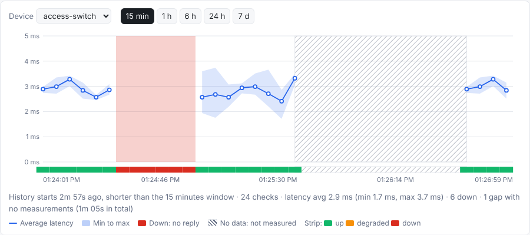
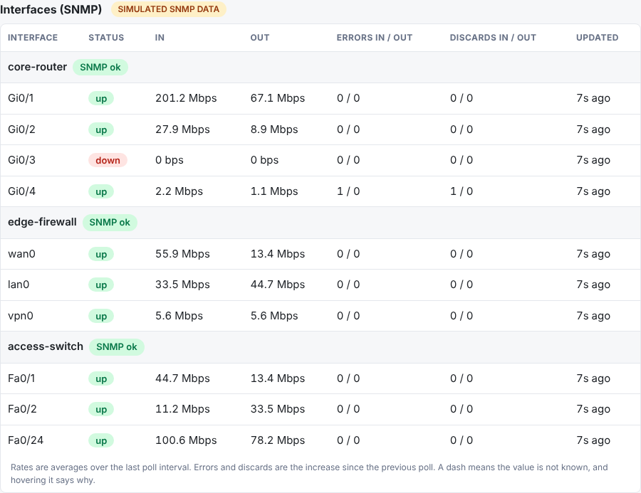
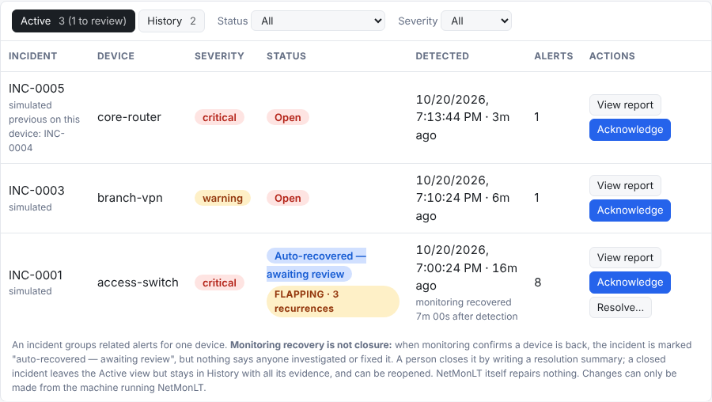
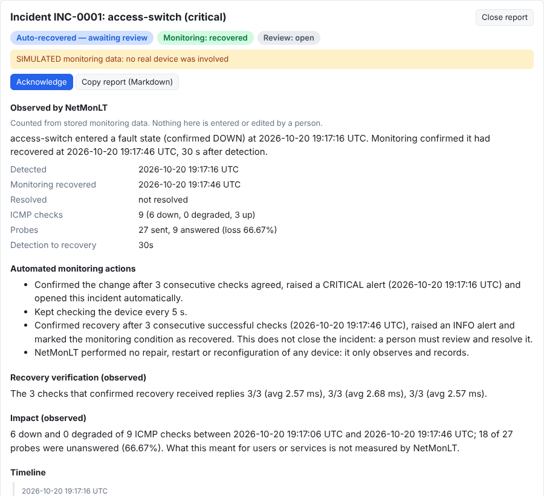

# NetMonLT demo walkthrough (about 5 minutes)

Everything here uses the default **simulated** devices: no network, no admin rights and no
hardware. The dashboard is labelled **SIMULATED DATA** throughout.

**Set up** (once, from the repository root; see the [README](../README.md#quick-start-simulated-demo)):

```powershell
uv sync
uv run netmonlt
```

Open <http://127.0.0.1:8000> straight away. The scripted outage happens 30 seconds after the app
starts, so don't leave it for later (if you miss it, the history is still there; see step 5).

## What happens, and when

| Time since start | What happens | Where to look |
|---|---|---|
| 0 to about 15 s | Seven devices appear. The first checks only establish a baseline, so there are no alerts yet. | Device table |
| 0 s onward | `wifi-ap` (40% packet loss) and `branch-vpn` (about 170 ms) show **degraded** by design. | Device table |
| 30 s | `access-switch` stops replying (the scripted outage). | Device table turns red; chart zone turns red |
| about 40 s | A **critical** alert: *"access-switch is DOWN: no reply to 3 pings (was up for 30s)"*. It waits for 3 consecutive failed checks. | Recent alerts, and the console |
| 60 s | The switch answers again. | Device table |
| about 70 s | An **info** alert: *"access-switch recovered ... (was down for 30s)"*, again after 3 consecutive good checks. | Recent alerts |
| about 40 s | **Incident management:** the critical alert also opens incident **INC-0001** for `access-switch`, status **Open**. | Incidents section |
| about 70 s | Monitoring confirms recovery: the incident becomes **Auto-recovered — awaiting review**. Nobody has investigated anything yet, so it stays in the Active view. | Incidents section |
| about 50 s onward | **Network quality** grades appear (10 checks are needed first): `voice-gateway` Fair because of jitter, `wifi-ap` Poor (loss), `branch-vpn` Poor (latency), the rest Excellent. | Network quality table |
| about 70 s | `access-switch` is Poor (its outage is counted as loss), then Fair after about 10 minutes, and Excellent again (via Good) as the outage leaves the 15-minute window. | Network quality table, loss chart |
| 60 s | **Wi-Fi (simulated):** the simulated signal drops from about 80% to about 25%. | Wi-Fi signal panel |
| about 75 s | A **Low signal** banner appears (3 consecutive readings at or below 40%), and the chart line crosses the dashed limit. | Wi-Fi signal panel |
| 100 s | The simulated signal recovers and the banner clears. | Wi-Fi signal panel |
| 130 to 150 s | The simulated link **disconnects**: a red "not connected" zone, no signal figure (never 0%), then it reconnects. | Wi-Fi signal panel |
| 60 s | **QoS (simulated):** congestion starts on `edge-firewall`'s wan0 egress policy. Best effort and Business surge; Voice, Video and Scavenger are unaffected. | QoS telemetry panel |
| 60 to 115 s | **Queue-specific drops:** Best effort drops about half its traffic, Business a little, while the priority Voice class stays at 0%. | QoS panel, Drops/s and Drop % charts |
| about 75 s | Best effort's 32-bit counters **roll over**: its rate carries on with no false reset. | QoS panel |
| 115 s | Congestion ends and the drops stop. | QoS panel |
| about 130 s | `edge-firewall` "restarts": QoS counters reset, one sample has no rate (a grey marker on the chart), then rates resume. | QoS panel |
| 30 to 60 s | SNMP to `access-switch` times out too (labelled as such); its interface rows dim and the last good values are kept, not zeroed. ICMP and the charts are unaffected. | Interfaces (SNMP) panel |
| about 75 s | `core-router` Gi0/1 crosses the 64-bit counter limit. The rate carries on unbroken instead of spiking or going negative. | Interfaces panel |
| about 100 s | `edge-firewall` vpn0 stops being reported and is shown as **absent**, with no rate. | Interfaces panel |
| about 130 s | `edge-firewall` "restarts": every counter and sysUpTime reset. One poll shows no rate (counter reset), then rates resume. | Interfaces panel |

## Steps

1. **Watch the device table.** Statuses, latency and loss refresh every 3 seconds. The "N s ago"
   labels count up every second in the browser from the age the API reported, without extra requests.
2. **See the outage (about 30 to 40 s).** `access-switch` goes DOWN with 100% loss and the
   critical alert appears. Meanwhile the lossy `wifi-ap` raises only the occasional alert: a change
   needs 3 consecutive checks to agree, so single lost packets don't cause alert noise.
3. **See the recovery (about 60 to 70 s).** The row turns green and the recovery alert appears.
4. **Open the history chart.** Under **Latency history**, `access-switch` is selected by default.
   The blue line stops where the outage starts, a **red zone** covers it, and the strip below
   shows red cells. Hover the red zone: *"No latency: no reply to any ping, Status: down"*. It is
   never drawn as 0 ms. Try the **1 h** and **24 h** buttons.
5. **Show NO DATA, which is not the same as DOWN.** Press **Ctrl+C** in the terminal, wait about a
   minute, then run `uv run netmonlt` again and refresh the page. The minute in between is a
   grey **hatched zone**. Hover it: *"No measurements ... not the same as down"*. There is no red
   zone, and **no alert was invented** for it. About 30 seconds later the scripted outage replays
   (a second red zone and alert), because the simulation restarts with the app.

   

6. **Interface statistics (SNMP, simulated).** Scroll to **Interfaces (SNMP)**. It is badged
   **SIMULATED SNMP DATA**. Each device lists its interfaces with status, in/out rates and
   error/discard counts per poll. Wait for the events in the table above: the access-switch
   timeout (30 to 60 s), the rollover (75 s), vpn0 disappearing (100 s) and the restart (130 s).
   A rate is shown as a dash with a tooltip whenever it cannot be calculated honestly (first
   sample, counter reset, gap): it is never invented. Raw counters are not exposed by the API
   (`/api/interfaces`).

   

7. **Network quality.** Scroll to **Network quality** (after about a minute). Each device has
   a latency, jitter and loss figure and a grade, with the **basis** column saying which figure
   limits it. `voice-gateway` has low latency and no loss but is **Fair** because of its jitter,
   which is the point of grading on more than latency. Pick `access-switch` in the device
   selector: the **loss chart** shows the outage as a red bar, and the **jitter line breaks**
   there instead of dropping to zero, because jitter cannot be measured without two consecutive
   replies. Use the window buttons to change the period for both the table and the charts. A
   device with too little data shows **Unknown** and says why; nothing is guessed.

   The grades come from thresholds in `config/devices.sim.yaml` (`quality:`). They are this
   app's own heuristics, not a QoS standard, and ICMP measurements cannot show that DSCP marking
   or traffic shaping works.

8. **Wi-Fi signal (simulated).** Scroll to **Wi-Fi signal (this computer)**, badged **SIMULATED
   WI-FI DATA**. The table says where each figure comes from ("simulated" here; on a real
   Windows PC "reported by Windows WLAN API"). The network name is masked (`H*******`) by
   default. RSSI is shown as its own row, labelled simulated: a real run shows a dash unless the
   driver reports an RSSI, and the app never calculates dBm from the percentage. Watch the dip
   and the low-signal banner (about 60 to 100 s), then the disconnection (about 130 s): it is a
   red zone, not a zero. This panel is local-only: it never scans for networks. On an
   Ethernet-only PC in real mode it would instead explain that there is no wireless adapter.

9. **QoS telemetry (simulated).** Scroll to **QoS telemetry (SNMP)**, badged **SIMULATED QoS
   DATA**. For each device it shows the adapter (here "simulated"), the source, the counter
   width and when each row was polled. Watch the Best effort row: during congestion (about 60
   to 115 s) its Drops/s and **Drop %** rise while Voice stays at 0%, and the **Throughput**
   chart shows the surge. Use the metric buttons for Throughput, Drops/s and Drop %, and the
   window buttons for the period. A dash means a rate could not be calculated and hovering says
   why (for example the sample straight after the restart). The panel's caption explains that
   this is different from the Network quality grades (ICMP), from interface discards, and from
   DSCP markings observed in traffic (which NetMonLT never inspects); counters existing does not
   prove QoS is enforced.

10. **Incidents: from alert to closed (simulated).** Scroll to **Incidents**, badged **SIMULATED
    INCIDENTS** (about 40 s in). It is built on top of the alerts, which are unchanged and still
    appear under **Recent alerts** as an event log.

    

    1. **Monitoring recovery is not closure.** At about 70 s the incident's status reads
       **Auto-recovered — awaiting review**. Monitoring (NetMonLT) says the device is back;
       the review state (people) is still *open*. Select **View report** to see the two kept
       apart (`Monitoring: recovered`, `Review: open`).
    2. **Read the write-up.** *Observed by NetMonLT* is counted from stored checks (in the demo roughly 6 down
       and 3 up checks, about two thirds of the probes unanswered) and says NetMonLT repaired nothing. The
       dashed **SIMULATED / ILLUSTRATIVE EXAMPLE** block is fictional: it names the scripted
       outage as the cause because the simulator defines one (a device with no scripted cause
       says none is defined), and its troubleshooting steps are labelled as not performed.

       

    3. **Acknowledge** it, then **Add a note** such as *"Checked the uplink: looks fine"*. Both
       appear in the timeline with a timestamp and the actor label (self-declared, there are no
       accounts). Try a note containing `<b>bold</b>` or `<script>alert(1)</script>`: it is shown
       as literal text.
    4. **Fill in the operator write-up**: set *Root cause status* to **Suspected** and write the
       cause, then **Save write-up**. The status *Confirmed* is refused without a stated cause.
       Nothing here is pre-filled: those fields are for a person.
    5. **Resolve.** Try **Resolve incident** with a short summary: it is refused (10 characters
       minimum). Write a real one and resolve: the incident leaves **Active** and appears under
       **History**, with its evidence frozen. It is never deleted.
    6. **Copy report** (or open `/api/incidents/1/report`) to get the write-up as Markdown, ready
       to paste into a ticket.
    7. **Reopen** it from History with a reason: it returns to Active as **Reopened**, with the
       earlier resolution kept in the timeline.
    8. **Flapping.** A fault that returns within 15 minutes of recovery is grouped into the same
       incident and marked **FLAPPING** once it has recurred twice; every alert keeps its own
       timestamp in the timeline. To see this, stop the app (Ctrl+C) and start it again within
       15 minutes without resolving the incident: the simulation replays its outage, and the
       second outage joins the same incident as a recurrence. A fault after the incident is
       **resolved** opens a *new* incident instead, linked to the earlier one.
    9. **Security.** Only the machine running NetMonLT can change incidents. Another computer that
       can reach the page sees everything but gets a read-only view (no buttons, and 403 from
       the API), even if you bind to `0.0.0.0`.

11. **Importing earlier alerts and the Recent alerts views.** Incident management only follows
    alerts raised after it was installed, so an existing database (like one from before the
    upgrade) shows alerts that no incident covers. To try this from scratch you need such a
    database: run the demo with the previous release, stop it, then start this release on the
    same `data/netmonlt.db`. (The older alerts stay in **Recent alerts** as "not in an incident".)

    1. In **Incidents**, the notice says "N earlier alerts are not part of any incident". Click
       **Preview import…**. The preview says how many incidents it would create, how many are
       auto-recovered, how many have **recovery unknown**, and how many alerts cannot be placed
       (a recovery with no recorded fault is never turned into an outage).
    2. Click **Import N incidents**. They appear in Active, badged *imported from alert history*,
       with the original alert times and messages and one note stamped with the import time. The
       alerts themselves do not change, and the notice disappears. Importing again does nothing.
    3. Open an imported incident whose recovery was recorded: **Auto-recovered — awaiting review**.
       Open one with **Recovery unknown**: the report says NetMonLT does not know whether or when it
       ended. To resolve it you must tick the confirmation and write a summary; the report then
       states that the resolution is your statement, not a monitoring confirmation.
    4. **Recent alerts** has three views. **Unresolved** is the default; resolve an incident and
       watch its alerts leave it and appear under **Archived / resolved**. **All alerts** always
       shows the complete history. **Reopen** the incident and its alerts return to Unresolved.
       Alerts that no incident covers stay in Unresolved until they are in an incident that is
       resolved, and other alerts from the same device are never hidden.

12. **Optional: the real mode, safely.** `uv run netmonlt --inventory config/devices.real.example.yaml`
   pings only your own computer (loopback). The badge changes to **LIVE · ICMP** and the data goes
   to a separate database. Latencies are tiny (well under 1 ms) because it is local.

To start over, stop the app and delete the `data/` folder (`Remove-Item -Recurse data` in
PowerShell, `rm -r data` elsewhere).

## Points to make

- **Measurement is separate from everything else.** The simulator and the real ICMP prober
  implement the same interface, so the collector, alerts, database and dashboard don't change.
- **Alerts need confirmation and survive restarts.** State changes are confirmed over 3 checks and
  stored, so noisy links don't flood the log and a restart neither repeats nor invents alerts.
- **"No data" is not "down".** A stopped monitor or a failing probe is shown as missing data, never
  as an outage, and never as a 0 ms reading.
- **SNMP is isolated and honest.** It has its own polling loop, so a failing device cannot delay
  ICMP or alerts. Rates come from counter differences over elapsed time, handling rollover,
  resets and missing interfaces. The real SNMPv3 client reads credentials from environment
  variables only; it was tested against a software agent on loopback, not network hardware.
- **QoS telemetry is device-reported and explicit.** It reads only counters from a documented
  adapter you name (today the standard DIFFSERV-MIB), never guesses OIDs, and shows "no QoS
  telemetry" for devices that do not expose it. It does not prove QoS works, and it is not DSCP
  observed in traffic. The simulation is labelled as scripted, not real equipment.
- **Wi-Fi telemetry is honest about its sources.** Each figure is reported, simulated or
  unavailable. Nothing is estimated, RSSI is never derived from a percentage, and the SSID is
  masked before it is stored. It is opt-in and reads only this computer's own adapter.
- **Quality figures are defined, not vague.** Jitter is the mean absolute difference between
  consecutive successful checks' average round-trip times (not RFC 3550, not one-way delay).
  Loss is probes unanswered over probes sent. Missing data is a gap, never a zero.
- **Performance is not QoS.** The grades describe how ICMP behaves. They do not prove that any
  prioritisation, shaping or queueing is in place.
- **Recovery is not resolution.** Monitoring state (set only by NetMonLT) and review state (set
  only by people) are separate fields. A device coming back shows "Auto-recovered — awaiting
  review", never "fixed", and a person cannot change what monitoring observed. Closing needs a
  written summary and is refused while the fault is still active.
- **Write-ups separate observed, operator-entered and example content.** Real incidents get
  observed evidence plus blank operator fields and no invented cause or steps. Only simulated
  incidents get a labelled fictional example, and it states a cause only if the simulator defines
  one.
- **Incident changes are local-only and non-destructive.** No endpoint deletes anything, the
  event trail is append-only, and state changes need a loopback client and a per-process token.
  In real mode, changes are off until your private inventory sets `incidents.operator_actions:
  true`. Known limits: no accounts, so the actor label is self-declared; only ICMP alerts create
  incidents; and the incident workflow has been tested against the simulator, not a real outage.
- **History can be imported without rewriting it.** The import replays stored alerts through the
  same correlation rules, only adds incidents, never touches an existing incident or alert, and
  cannot duplicate. Where history is incomplete it says "recovery unknown" instead of guessing, and
  it never turns a recovery with no fault into an outage.
- **Resolved alerts are archived, not deleted.** The default alert view hides only alerts of
  resolved incidents; the full history stays one click away and in each incident's report.
- **Real monitoring is opt-in and bounded.** It needs a separate file, `authorized: true` per
  device and single-host targets only. There is no scanning or discovery.
